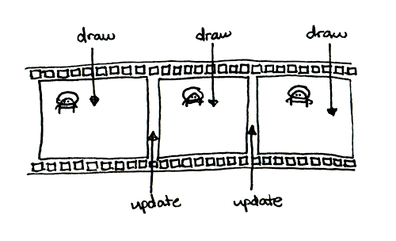
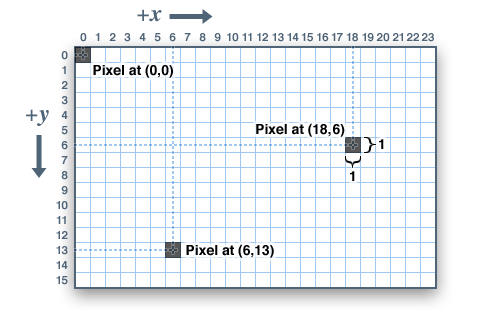
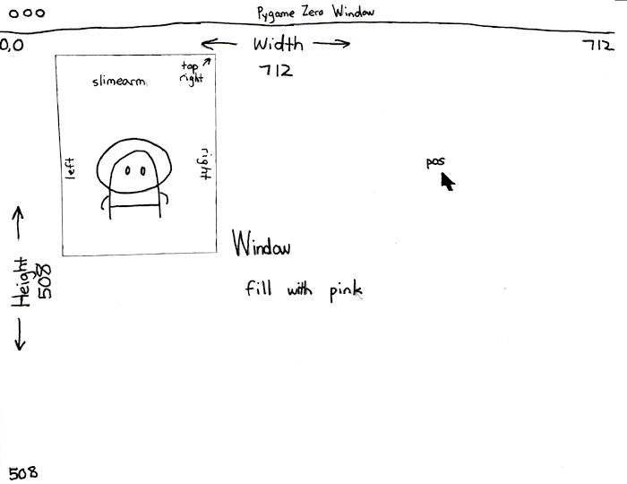
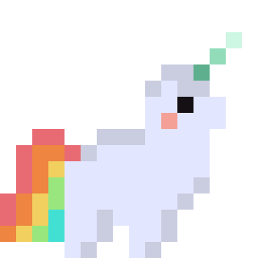
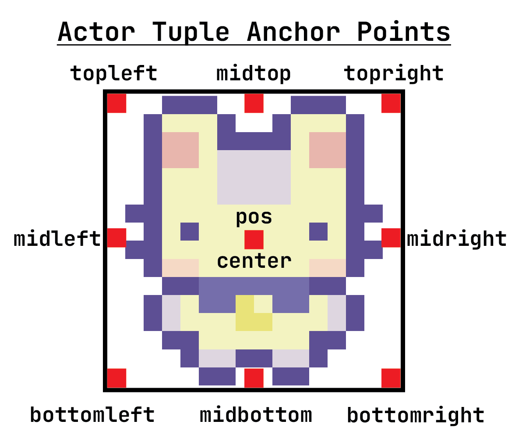
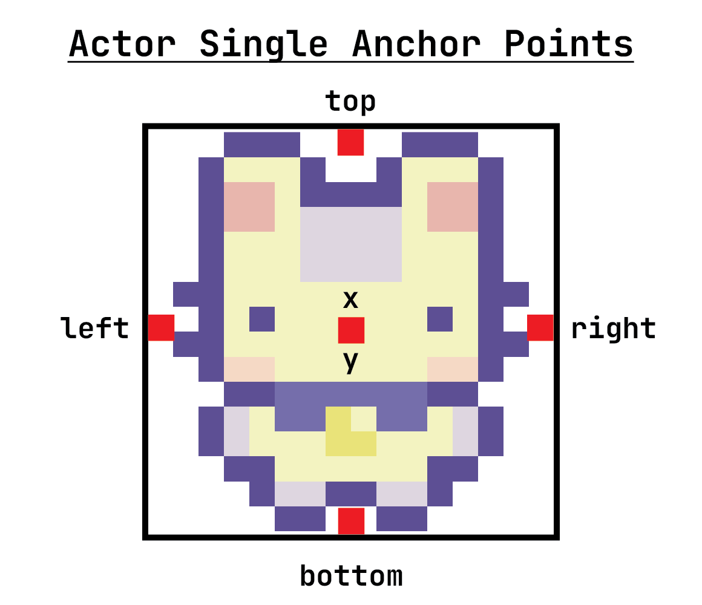

## Introduction to Pygame Zero

- A library that makes it easier to create games by hiding some of the more complex Pygame syntax.
- It provides functions to handle graphics, sound, and events like key/mouse input to create 2D games.
- For more complex games, developers typically use game engines, like Godot, Unity and Unreal Engine.

::: notes
/introduction.html
:::

## Pygame Zero Setup



## The Game Loop

When the program runs, Pygame Zero calls `start()` once. Then `draw()` and `update()` are called over and over until the window is closed.

`start()` → `draw()` → `update()` → `draw()` → `update()` → ...

**You cannot change the names of these functions!** Pygame Zero looks for these exact names.

## The Game Loop

You can think of it as an infinite flipbook that is updated between frames.

{fig-align="center" width="70%"}

::: notes
https://www.mattlayman.com/blog/2019/teach-kid-code-pygame-zero/
:::

## Basic Game Structure {.smaller}

:::: {.columns}
::: {.column width="58%"}
::: {.code-small}
```{.python include="/e00starter.py"}
```
:::
:::
::: {.column width="42%"}

:::
::::

# Screen & Shapes

## Graphical User Interface (GUI)

:::: {.columns}
::: {.column width="55%"}
A window with visual elements that lets the user interact with the code behind the scenes.



- `WIDTH`: constant that sets the screen width
- `HEIGHT`: constant that sets the screen height
:::
::: {.column width="45%"}

:::
::::

## Tuples



## Drawing Order {.smaller}

:::: {.columns}
::: {.column width="45%"}

:::
::: {.column width="55%"}
```{.python include="code/draw_order.py" snippet="constants"}
```
```{.python include="code/draw_order.py" snippet="draw"}
```
:::
::::

## Drawing Rectangles and Lines

```{.python include="code/drawing_shapes.py" snippet="rect" dedent=4}
```

```{.python include="code/drawing_shapes.py" snippet="line" dedent=4}
```

## Drawing Circles and Colors

```{.python include="code/drawing_shapes.py" snippet="circle" dedent=4}
```



## Drawing Text

Add text with `screen.draw.text()`. You can also set color, position anchor, font size, background color, word wrap and more ([text tutorial]()).

```{.python include="code/drawing_shapes.py" snippet="text" dedent=4}
```

# Actor

## Objects

In Pygame Zero, many things in our program are **objects**. An object contains:

- **Data**: information about the object, such as its position and image
- **Behavior**: things the object can do, such as `draw()`

## The Actor

An `Actor` is a graphic you draw in the window, like a sprite in Scratch.

```{.python include="code/actor_basics.py" snippet="create"}
```
```{.python include="code/actor_basics.py" snippet="position" dedent=4}
```
```{.python include="code/actor_basics.py" snippet="draw"}
```

{.absolute bottom=20 right=0 width="200"}

## Moving and Changing an Actor

Images go in the `images` folder. Use the name without `.png`.

```{.python include="code/actor_basics.py" snippet="move"}
```
```{.python include="code/actor_basics.py" snippet="image" dedent=4}
```

## Actor Positions {.smaller}

:::: {.columns}
::: {.column width="68%"}
```{.python include="code/actor_positions.py" snippet="pairs" dedent=4}
```
```{.python include="code/actor_positions.py" snippet="single" dedent=4}
```
:::
::::

{.absolute top=60 right=0 width="300"}
{.absolute top=330 right=0 width="300"}

# Global Variables

## Global Variables

In Pygame Zero, we write almost all our code in functions. How do we keep data across functions, or across many calls to `update()`?

**Global variables!**

1. Define them outside all functions, at the top of the file.
2. Any function can read them freely.
3. A function that *changes* one needs one extra step...

## The `global` Keyword



Use global variables sparingly: they make programs harder to understand and debug.

## Global Variable Example

```{.python include="code/global_frame.py" snippet="program" code-line-numbers="|2|15|16|17-18"}
```

# Actor Variables

## Actor Variables

An alternative to global variables: attach your own variables to an Actor with dot notation. Only use them for values that belong to that Actor.

- Built-in: `x`, `y`, `pos`, `image`...
- Your own: anything you create, like `velocity_x`

## Actor Variable Example

```{.python include="code/actor_variables.py" snippet="program" code-line-numbers="|4-7|15-17"}
```
