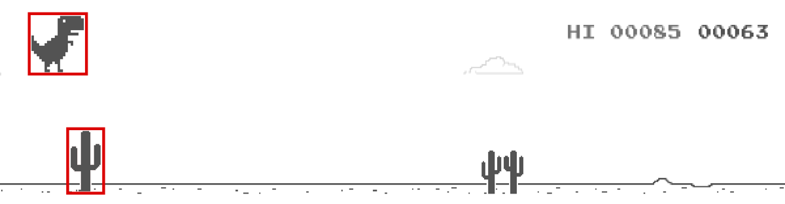

# Collisions

## Hitbox

Per Wikipedia, "A hitbox is an invisible shape commonly used in video games for real-time collision detection. It is often a rectangle or cuboid that is attached to and follows a visible object, though circular or spheroidal shapes are also common."

In Pygame, we have a rectangular hitbox around an Actor's image.

{fig-align="center" width="85%"}

## Detecting Collisions

- **`colliderect()`**: method called on one Actor to detect if there's a collision with another Actor.
- Returns `True` if there's a collision, `False` otherwise.
- Also works between Actors and Rectangles.

```python
unicorn = Actor("unicorn")
monster = Actor("monster")

if unicorn.colliderect(monster):
    # game over
```

## Detecting Collisions with Multiple Actors

```python
player = Actor("p1")  # create player Actor
bat = Actor("bat")  # create bat enemy Actor
coin = Actor("coin")  # create coin Actor
...
if player.colliderect(bat):  # collision with enemy
    player.health -= 1
if player.colliderect(coin):  # collision with coin
    player.money += 1
```

# Game State

## The `game` Object

- `game` stores information about your game's state.
- Keeps everything in one place.

:::: {.columns}
::: {.column width="50%"}
Instead of lots of globals:

```python
score = 0
level = 1
timer = 0
```
:::
::: {.column width="50%"}
Use:

```python
game.score = 0
game.level = 1
game.timer = 0
```
:::
::::

## `game`

```{.python include="code/game_object.py" snippet="attributes" dedent=4}
```

## What is Game State

- `"playing"` → normal gameplay
- `"won"` → player won
- `"lost"` → player lost
- `"over"` → game is over (no difference between win/lose)
- `"paused"` → temporarily stopped

Check using:

```python
if game.state == "playing":
    player.x += 3
```

Update using: `game.win()`, `game.lose()`, `game.over()`, etc.

## Changing State / Ending a Game

```{.python include="code/game_object.py" snippet="end" dedent=4}
```

```{.python include="code/game_object.py" snippet="pause" dedent=4}
```

While paused, `game.timer` and Sprite animations stop, but `update()` and the clock keep running.

## Restarting a Game

Instead of ending, we can restart a game by adding a number!

```{.python include="code/game_object.py" snippet="restart" dedent=4}
```

- Everything listed before still happens right away: changes `game.state` to `"won"`, `"lost"` or `"over"` and clears the clock.
- Then, after that many seconds, it restarts the game: resets `game` (score 0, level 1, timer 0, state `"playing"`) and runs the `start()` function again.

**Note:** these do not execute unless `game.state` is `"playing"` when they are called. They are skipped otherwise, to prevent multiple restarts from being scheduled when called repeatedly in `update()`.

## Heads-Up Display (HUD)

- Shows the player info about the current game state.
- Common HUD elements: score, health, lives, time, items, etc.
- HUD elements are drawn on top of the game, at the end of `draw()`.

::: {style="font-size: 0.9em"}
```{.python include="code/hud.py" snippet="draw"}
```
:::

## Example

Check state in `draw()`.

```{.python include="code/game_state_example.py" snippet="start"}
```
```{.python include="code/game_state_example.py" snippet="draw"}
```

## Example (continued)

The first 2 lines prevent the rest of `update()` from running by returning if `game.state` is not `"playing"`. Change state and trigger a restart with `game.lose()`.

```{.python include="code/game_state_example.py" snippet="update"}
```
