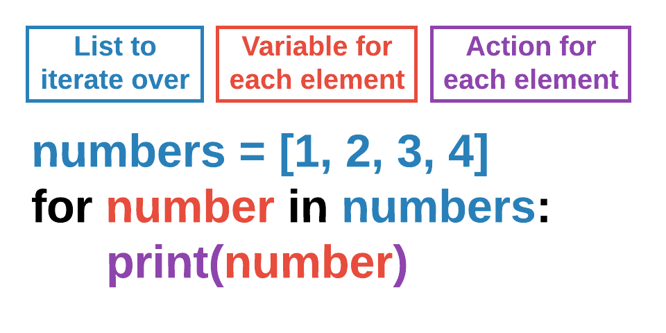

::: {.content-visible when-format="html"}
Every code block has a copy button (top right). [Download the printable PDF](u4m1-cheatsheet.pdf).
:::

## Assets



## Lists



Note: indexes start at 0! You can also use negative indexes, which count from the end.

```{.python include="code/list_basics.py" snippet="nums_demo"}
```

## List operations



```{.python include="code/list_basics.py" snippet="pets"}
```

## Looping over a list




{width="55%"}

## Drawing a list of Actors

We use a `for` loop to iterate/loop over a list of Actors. This shows how to draw each Actor in a list.

```{.python include="code/enemy_list.py" snippet="draw"}
```

## Moving a list of Actors

Another loop/list example: iterate over a list of Actors to change each individual Actor's position by its own velocity variables.

```{.python include="code/enemy_list.py" snippet="move"}
```

## Collisions with a list

`player.collidelist(enemies)` returns the index of the enemy in the list that collided with `player`, or `-1` if there was no collision. Use `!= -1` just to know *whether* a collision happened (a lose condition). Keep the index to know *which* item was hit, then `pop()` that item from the list.

```{.python include="code/enemy_list.py" snippet="collide" dedent=4}
```

## Putting it all together

- Define lists as global variables at the top so they can be accessed across the program.
- In this program we periodically add enemies to the screen, so `start()` empties the list (at start and restart) and starts a clock interval that calls `spawn_enemy()` every 5 seconds.
- `spawn_enemy()` creates a new enemy Actor, sets its own `pos` and velocity, and appends it to the list. These apply to that one single Actor, and the variable `enemy` does not exist outside this function: you have to reach that Actor by iterating through `enemies`!
- `draw()` loops over the list to draw each Actor; `update()` loops over it to move each Actor, then uses `collidelist()` for a lose condition and to collect gems.

```{.python include="code/enemy_list.py" snippet="program"}
```
