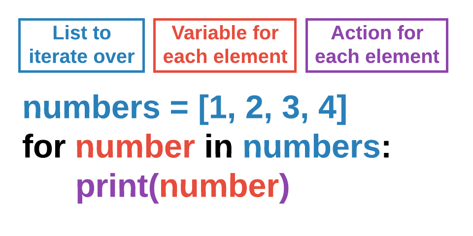

## Creating a List



```{.python include="code/list_basics.py" snippet="define"}
```

| index | 0 | 1 | 2 | 3 | 4 | 5 |
|---|---|---|---|---|---|---|
| **value** | 2 | 4 | 6 | 8 | 10 | 12 |
| **name** | `nums[0]` | `nums[1]` | `nums[2]` | `nums[3]` | `nums[4]` | `nums[5]` |

## List Operations



## Example

```{.python include="code/list_basics.py" snippet="fruits"}
```

## Iterating Over a List



{fig-align="center" width="45%"}

# Pygame Lists

## Creating a List of Actors

:::: {.columns}
::: {.column width="34%"}
- Define the list as a global.
- Figure out where to add new Actors. This example does it based on an interval.
- Create a function to create a new Actor and append it to the list.
:::
::: {.column width="66%"}
```{.python include="code/enemy_list.py" snippet="spawn"}
```
:::
::::

## Drawing a List of Actors

- We use a `for` loop to iterate/loop over a list of Actors.



- This shows how to draw all Actors in the list on the screen.

```{.python include="code/enemy_list.py" snippet="draw"}
```

## Moving a List of Actors

You can use the same style of `for` loop in `update()`.

See the example below, where we update each individual Actor's position based on its own velocity.

```{.python include="code/enemy_list.py" snippet="move"}
```

# List Collisions

## Collisions with a List of Actors

- **`collidelist()`**: similar to `colliderect()`, but called on one Actor to detect if there's a collision with a *list* of Actors.
- Returns the index of the Actor in the list causing the collision (`-1` if none).

```{.python include="code/enemy_list.py" snippet="collide" dedent=4}
```
