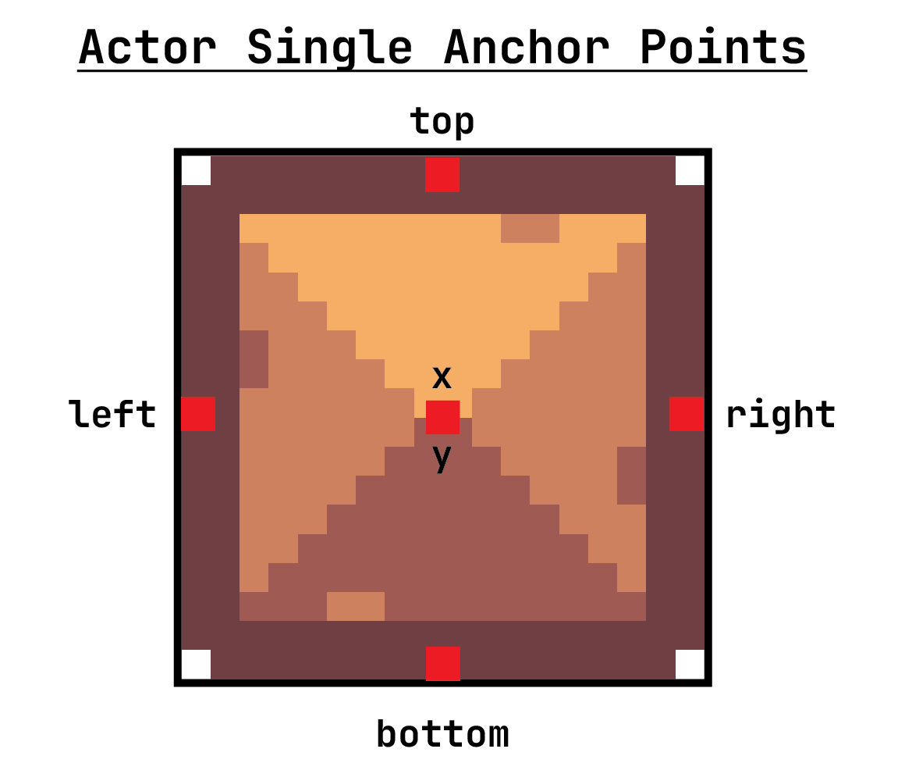
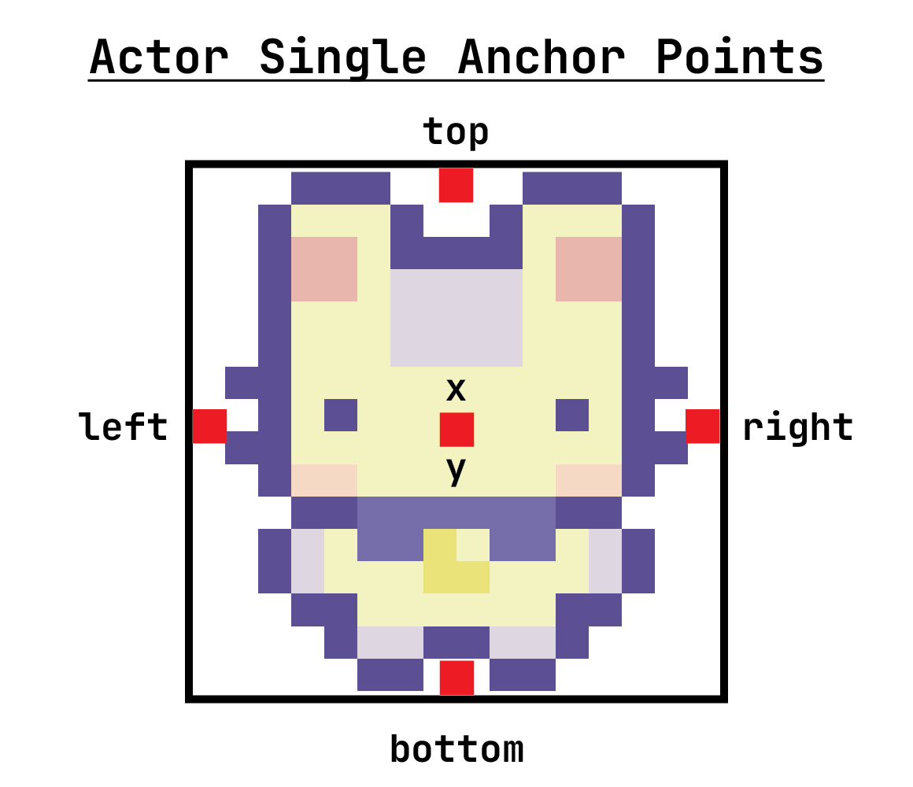

# Actor Extensions

## Actor Extensions

```{.python include="code/actor_extensions.py" snippet="extensions" dedent=4}
```

## Sprite

```{.python include="code/rabbit_game.py" snippet="idle"}
```

::: {style="font-size: 0.75em"}

:::

## Playing a Sprite

Actors can play Sprites. Give it a Sprite instead of an image name.

```{.python include="code/rabbit_game.py" snippet="walk_sprites"}
```
```{.python include="code/rabbit_game.py" snippet="actor"}
```
```python
...
```
```{.python include="code/rabbit_game.py" snippet="switch" dedent=8}
```

## Controlling Animations

```{.python include="code/fox_animation.py" snippet="sprites"}
```
```{.python include="code/fox_animation.py" snippet="control" dedent=4}
```

# TileMaps

## Tilesheets / Tilesets / Tilemaps {.smaller}



## Import Tilemap



```{.python include="code/rabbit_game.py" snippet="layers"}
```

## Pygame Constants

You can create your own constants to compute screen size!

```{.python include="code/rabbit_game.py" snippet="constants"}
```

# TileMap Collisions

## TileMap Collisions

:::: {.columns}
::: {.column width="50%"}

:::
::: {.column width="50%"}

:::
::::

## Handling Wall Collisions

```{.python include="code/rabbit_game.py" snippet="wall_collision" dedent=4}
```
